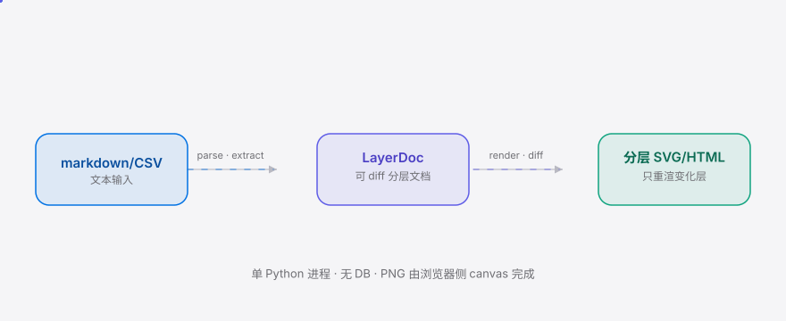

<div align="right"><sub><b>English</b>&nbsp;&nbsp;|&nbsp;&nbsp;<a href="./README.md">简体中文</a></sub></div>

<p align="center">
  <picture>
    <source media="(prefers-color-scheme: dark)" srcset="./assets/hero-dark.svg">
    <source media="(prefers-color-scheme: light)" srcset="./assets/hero-light.svg">
    
  </picture>
</p>

<p align="center"><sub>A layered SVG/HTML long-image tool for WeChat Official Account / Xiaohongshu authors — change one data point and only that layer re-renders, diffable, no more redrawing the whole image.</sub></p>

<p align="center">
  <a href="./LICENSE"></a>
  <a href="https://github.com/SuperMarioYL/layerlong/releases"></a>
  <a href="https://github.com/SuperMarioYL/layerlong/actions/workflows/ci.yml"></a>
  
  
</p>

<p align="center"><b>Redraw the whole long image just to change one number? layerlong replaces flat PNG with layered SVG/HTML long images — change one data point, see the per-layer diff, re-render only the changed layer, never redraw the whole thing.</b></p>

---

<h2> Architecture</h2>

<p align="center">
  <picture>
    <source media="(prefers-color-scheme: dark)" srcset="./assets/atlas-dark.svg">
    <source media="(prefers-color-scheme: light)" srcset="./assets/atlas-light.svg">
    
  </picture>
</p>

A single Python process: markdown/CSV/text → **LayerDoc** (a diffable layered long-image document) → the renderer produces editable layered SVG/HTML (each layer an addressable `<g id>` / `<section id>`). Changing one data point affects only the layer mapped to it; the diff is visible at layer granularity, and the renderer re-renders only changed layers. PNG export is done browser-side via canvas, avoiding cairo system dependencies.

## Contents

- [Why this exists](#why-this-exists)
- [Install & Quickstart](#install--quickstart)
- [Usage](#usage)
- [Demo](#demo)
- [Configuration](#configuration)
- [Pricing](#pricing)
- [Roadmap](#roadmap)
- [License](#license)

<h2> Why this exists</h2>

Authors of "information long images" on WeChat Official Accounts and Xiaohongshu get a flat PNG back today — every layer is flattened on export. When an author finds a wrong number, or wants to update a title figure for a new issue, they must reopen the Figma/PS source, locate it by hand, change it, re-export the whole PNG, and re-upload.

layerlong treats a long image as a layered vector project file with semantic regions: every title, data row, and annotation is an addressable layer you can edit in place and compare against the previous version — no full redraw. The new primitive is **LayerDoc**, an editable, diffable layered long-image document that does not exist in any competitor.

<h2> Install & Quickstart</h2>

```bash
git clone https://github.com/SuperMarioYL/layerlong.git && cd layerlong
pip install -e .
layerlong render examples/sample.md -o out/
```

<details><summary>sample output</summary>

```
已渲染 → out/long.svg + long.html
```

`out/` contains three artifacts:

- `long.svg` — layered, editable SVG (each layer a `<g id="...">`)
- `long.html` — layered HTML long image (each layer a `<section id="...">`)
- `long.json` — the LayerDoc source (an author-owned asset you can edit again and again)

</details>

Change one number, re-render with `--prev` to see the diff:

```bash
sed 's/23.5/31.2/' examples/sample.md > sample_v2.md
layerlong render sample_v2.md -o out2/ --prev out/long.json
# → diff: 1 / 11 layers changed, changed layers → ['stat-1']
```

<h2> Usage</h2>

`layerlong` has three subcommands: `render`, `extract`, `diff`.

**1. Render markdown/CSV/JSON → layered long image**

```bash
layerlong render examples/sample.md -o out/ --platform gzh
layerlong render data.csv -o out/ --platform xhs
layerlong render long.json -o out/        # render a saved LayerDoc directly
```

**2. Per-layer diff after a data change (re-render only the changed layer)**

```bash
layerlong render sample_v2.md -o out2/ --prev out/long.json
# produces out2/long.diff.html, highlighting only changed layers
layerlong diff out/long.json out2/long.json
# prints per-layer added/removed/changed/unchanged
```

**3. One-shot extract of structured draft from free text (mock by default, zero API key)**

```bash
layerlong extract raw_text.txt -o draft/ --model mock
# optional domestic models (bring your own key): --model deepseek|qwen|glm, export LAYERLONG_API_KEY
layerlong render draft/long.json -o out/
```

The markdown schema is tiny:

```
# Title                       → title layer
## Section                    → section layer
stat: label | value | unit    → stat layer (changing the value touches only this layer)
chart: label,value; label,value;… → chart layer (bars)
---                           → divider layer
> source / note               → annotation layer
```

<h2> Demo</h2>

<p align="center"></p>

Left half = flat PNG: change one data point → the whole image flashes + "redraw 整张". Right half = layered SVG: same change → only the changed layer highlights + re-renders, "1 layer changed". layerlong's moat is editable layered vector graphics, not a one-shot bitmap.

<h2> Configuration</h2>

Canvas presets (v0.1 ships only the two Chinese-platform surfaces):

| Preset | `--platform` | Canvas width | Margin | Title safe zone |
|---|---|---|---|---|
| WeChat OA | `gzh` | 750 | 40 | top 80px |
| Xiaohongshu | `xhs` | 1080 | 56 | top 120px |

Environment variables (model extraction only; not needed for mock):

| Variable | Meaning |
|---|---|
| `LAYERLONG_API_KEY` | API key for domestic models (DeepSeek/Qwen/GLM, OpenAI-compatible) |

<h2> Pricing</h2>

**v0.1 is fully free and open source** — the mock extraction backend needs zero API keys, and the core diff / rendering / template engine are all open. The moat is format ownership (LayerDoc); closing it off would weaken network effects, so the core stays open.

Paid layers arrive in **v0.2+** (explicitly excluded from v0.1, but a commercial audience needs a monetization story):

- **One-off watermark-free HD export** — ¥9.9/image: the free web preview exports PNGs with a light watermark + limited resolution; unlock that one image's HD watermark-free export with a single tap before publishing (the lowest-friction pay gate).
- **Premium template packs** — ¥39–99/pack: brand colors / fonts / logos locked into a LayerDoc template; a continuing acquisition funnel.
- **Brand kit + hosting** — ¥99/month or ¥888/year: brand locking + watermark-free high-resolution PNG export.
- **Team plan** — ¥999/month (≤5 seats): shared LayerDoc sources + collaboration comments.

The LayerDoc source always stays in the author's local / OSS repo; the hosted layer stores only premium templates and brand-kit config — avoiding the trust risk of locking user content into the cloud.

<h2> Roadmap</h2>

- [x] **m1** hardcoded layered SVG PoC + per-layer diff (interview gate)
- [x] **m2** renderer: markdown/CSV → layered SVG/HTML + per-layer diff (re-render only changed layers) — CLI `layerlong render` works
- [ ] **m3** FastAPI preview page (paste markdown → layered long image → change one datum → diff highlight → browser-side PNG export) + publish to GitHub / Gitee
- [ ] v0.2 visual drag-drop layer editor, template marketplace, brand kits, CLI PNG export, multi-size canvas

<h2> License</h2>

MIT — see [LICENSE](./LICENSE). File bugs / template requests in [Issues](https://github.com/SuperMarioYL/layerlong/issues), or send a PR directly.

<p align="center"><sub><a href="./LICENSE">MIT</a> © 2026 SuperMarioYL</sub></p>
