[English](./README.en.md) · [Website](https://layerlong.lei6393.com) · [GitHub](https://github.com/SuperMarioYL/layerlong)

<picture>
  <source media="(max-width: 600px) and (prefers-color-scheme: dark)" srcset="./assets/presentation/hero-mobile-dark.svg">
  <source media="(max-width: 600px)" srcset="./assets/presentation/hero-mobile-light.svg">
  <source media="(prefers-color-scheme: dark)" srcset="./assets/presentation/hero-dark.svg">
  
</picture>

# layerlong

**逐图层检查信息长图的变化。**

layerlong 用结构化 LayerDoc 保存信息长图，并导出可编辑 SVG、HTML 与 JSON 源文件。

## 为什么需要它

指标更新时，扁平图片难以指出具体改了哪里。稳定图层 ID 让你比较语义内容，并保留下一次修改所需的源文件。

- **保留可编辑源** — 图片导出后仍保留 LayerDoc JSON。
- **按图层比较** — 变化对应图层 ID 与内容。
- **导出矢量与 HTML** — 同一文档可生成 SVG 与 HTML。

## 架构

<picture>
  <source media="(max-width: 600px) and (prefers-color-scheme: dark)" srcset="./assets/presentation/architecture-mobile-dark.svg">
  <source media="(max-width: 600px)" srcset="./assets/presentation/architecture-mobile-light.svg">
  <source media="(prefers-color-scheme: dark)" srcset="./assets/presentation/architecture-dark.svg">
  
</picture>

Markdown 与 CSV 解析器生成 LayerDoc；渲染器为全部图层写出 SVG 和 HTML。diff_docs 按 ID 配对并比较 kind/data，差异视图高亮变化层。当前 CLI 会重新生成完整文件，并未缓存仅有变化的渲染工作。

| 组件 | 职责 |
| --- | --- |
| `Input parser` | layerlong/parser.py |
| `LayerDoc` | layerlong/models.py |
| `Layer diff` | layerlong/diff.py |
| `SVG / HTML` | layerlong/renderer.py |

## 安装与快速上手

使用仓库清单指定的运行时版本构建，并在仓库根目录运行示例。

```bash
git clone https://github.com/SuperMarioYL/layerlong.git
cd layerlong
uv venv .venv
uv pip install --python .venv/bin/python -e .
source .venv/bin/activate
```

把随仓增长率从 23.5 改为 31.2，计算图层差异，并在内存中生成 SVG。

```bash
.venv/bin/python examples/presentation-demo.py
```

## 实际运行示例

<picture>
  <source media="(max-width: 600px) and (prefers-color-scheme: dark)" srcset="./assets/presentation/process-mobile-dark.svg">
  <source media="(max-width: 600px)" srcset="./assets/presentation/process-mobile-light.svg">
  <source media="(prefers-color-scheme: dark)" srcset="./assets/presentation/process-dark.svg">
  
</picture>

The recorded result identifies the changed semantic layer while the other layers remain unchanged.

```text
{
  "layers": 11,
  "changed_ids": [
    "stat-1"
  ],
  "unchanged": 10,
  "svg_produced": true
}
```

完整命令与输出保存在 [docs/demo-results.json](./docs/demo-results.json). 输入和复现代码均随仓提供。

## 用法

CLI 提供以下操作。示例之外的命令需要替换成你的文件路径或标识。

```bash
layerlong render examples/sample.md -o out/
layerlong render data.csv -o out/ --platform xhs
layerlong diff previous.json current.json
layerlong extract text.txt -o out/ --model mock
```

## 配置

render 接受 Markdown、CSV 与 LayerDoc JSON。--platform 选择 gzh 或 xhs，--out 指定输出目录，--prev 添加差异 HTML。extract 默认 mock；在线抽取需要对应提供方配置。

## 集成与职责分工

<picture>
  <source media="(max-width: 600px) and (prefers-color-scheme: dark)" srcset="./assets/presentation/integrations-mobile-dark.svg">
  <source media="(max-width: 600px)" srcset="./assets/presentation/integrations-mobile-light.svg">
  <source media="(prefers-color-scheme: dark)" srcset="./assets/presentation/integrations-dark.svg">
  
</picture>

以下路径已有源码实现。按任务选择输入，并把生成的结果与项目一起保存。

| 路径 | 已实现职责 |
| --- | --- |
| Markdown / CSV | Structured infographic input |
| LayerDoc JSON | Saved editable source |
| SVG / HTML | Layer-addressable exports |
| Diff HTML | Semantic change highlights |

## 限制与后续方向

- 仅坐标变化不计为语义变化；diff 比较图层 kind 与 data。
- 当前 CLI 重写完整输出。较少的变化图层不代表已实现增量渲染加速。
- 示例使用确定性解析，不验证可选模型抽取。

真正的增量渲染与更多导出验证是后续方向。编辑时保留 LayerDoc，便于比较明确的结构化版本。

## 许可与贡献

许可见 [LICENSE](./LICENSE). 反馈问题时请提供最小输入、执行命令和实际输出。
